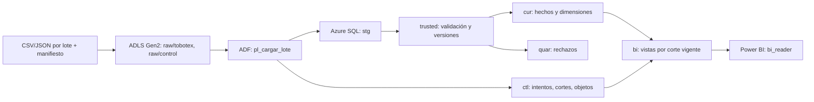

# Arquitectura y diseño — Fase 3

> Documento preliminar. Actualizar con región real, identidades, nombres de recursos y decisiones finales de implementación.

## 1. Objetivo

Definir la arquitectura cloud para ingestar lotes, validar/calificar datos, publicar cortes consistentes y exponer KPIs en Power BI para Tobotex y Anexo E.

## 2. Diseño A (propuesto)

**Componentes:** ADLS Gen2 (raw) + Azure Data Factory (orquestación) + Azure SQL Database (stg/trusted/cur/bi/ctl/quar) + Power BI.

**Flujo:**

## 3. Diseño B (alternativa evaluada)

**Componentes:** ADLS Gen2 (raw/curated parquet) + ADF/Synapse pipelines + Synapse Serverless SQL + Power BI.

| Criterio | Diseño A: ADF + Azure SQL | Diseño B: ADLS/Parquet + Synapse Serverless |
|---|---|---|
| Costo | Bajo para volumen pequeño; SQL free tier puede cubrir. Requiere estimación real. | Puede ser bajo en almacenamiento, pero costos por TB escaneado/operación según uso. Requiere estimación comparable. |
| Frecuencia | Adecuado para lotes pequeños/eventuales. | Adecuado para analítica sobre archivos; menos natural para transacciones de publicación. |
| Operación | SQL familiar; procedimientos, transacciones y auditoría simples. | Más piezas y manejo de archivos/parquet; publicación atómica más compleja. |
| Seguridad | Roles SQL claros (`etl_loader`, `bi_reader`), DENY/GRANT por esquema. | Seguridad en storage + vistas serverless; mayor superficie de configuración. |
| Ajuste PC3 | Alto: P8/publicación atómica y reintentos se manejan bien con transacciones SQL. | Medio/bajo para este volumen y requisito de puntero atómico. |

**Decisión preliminar:** Diseño A, por volumen pequeño, necesidad de publicación atómica por puntero/corte y operación SQL conocida. No afirmar menor costo sin evidencia comparable en Anexo D.

## 4. Capas y responsabilidades

| Capa | Ubicación | Responsabilidad |
|---|---|---|
| Raw | ADLS Gen2 `raw/` | Archivo recibido intacto + manifiesto/hash. |
| Staging | `stg` | Copia textual temporal por intento; sin tipificación destructiva. |
| Trusted | `trusted` | Datos validados/tipificados, versiones, hash, trazabilidad. |
| Quarantine | `quar` | Rechazos con control, motivo, clave, hash y fila. |
| Curated | `cur` | Dimensiones/hechos con historia por corte. |
| BI | `bi` | Vistas de consumo filtradas por corte vigente. |
| Control | `ctl` | Lotes, intentos, cortes, objetos, período revisado. |

## 5. Identidades y conexiones (completar)

| Conexión | Identidad | Permiso | Uso |
|---|---|---|---|
| ADF -> ADLS | Managed Identity ADF | Storage Blob Data Reader en raw | Leer lotes/manifiestos |
| ADF -> SQL | `etl_loader` | DML staging + EXEC procedimientos | Cargar/validar/publicar |
| Power BI -> SQL | `bi_reader` | SELECT en `bi` | Consumo de KPIs |
| Admin | `sqladmin` | DDL/admin | Despliegue controlado |

## 6. Contratos y evolución

- Contratos versionados por fuente en `contratos/`.
- Aceptar campos opcionales nuevos si el mapeo los maneja.
- Rechazar eliminación/renombre de campos requeridos o cambios incompatibles (C1).
- Manifiesto: evidencia; no reemplaza inspección del archivo.

## 7. Pendientes para cerrar 3.1

- [ ] Confirmar región real y nombres finales de recursos.
- [ ] Adjuntar diagrama final exportado (PNG/SVG/PDF) con identidades.
- [ ] Confirmar si control usa misma DB o DB separada.
- [ ] Actualizar decisión con costos observados/estimados reales.
