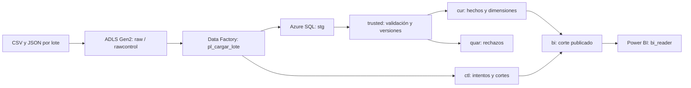

# PC3 Tobotex: guía paso a paso de fase 3

**Responsable:** Edward. **Duración orientativa:** 9–11 horas, si fase 2 funciona.

**Base:** [PC3_division_y_flujo.md](PC3_division_y_flujo.md), secciones 2, 5 y 6.5–6.14.

**Resultado:** pipeline parametrizado, publicación segura, pruebas P1–P8, Capítulo 3, conclusiones, anexos C/D/F y paquete reproducible.

Esta guía describe trabajo pendiente. No acredita ejecuciones ni resultados reales. Solo se recibió el documento de planificación; adapta ejemplos al esquema entregado por Rolando.

## 1. Recibir fase 2 y comprobar requisitos — 30 minutos

1. Lee `README.md`, sección «Estado del relevo».
2. Comprueba acceso al repositorio, Azure, almacenamiento, Data Factory y ambas bases.
3. Identifica región, grupo de recursos, servidor SQL, bases y responsables.
4. Recibe estos archivos:
   - Scripts `00`–`09` y `11`, contratos y generador con semilla 2026.
   - Lotes L0, L1, L2, L3 y LX; manifiestos con filas y SHA-256.
   - Tablero `.pbix`, Capítulo 2 y anexos A, B, E.
   - Presupuesto estimado de Freddy.
5. Comprueba consultas de lectura:

```sql
SELECT DB_NAME() AS base_actual;
SELECT * FROM ctl.corte ORDER BY corte_seq;
SELECT * FROM ctl.corte_vigente;
SELECT * FROM ctl.corte_objeto ORDER BY corte_seq, objeto;
SELECT * FROM bi.v_k1;
SELECT * FROM bi.v_k2;
SELECT * FROM bi.v_k3;
```

6. Anota corte actual, volúmenes, KPIs y problemas encontrados.
7. Guarda exportaciones y capturas en `evidencias/relevo/`.

**Condición para continuar:** consultas funcionan; contratos, datos y scripts disponibles. Si falta una pieza, registra el bloqueo y resuélvelo antes de probar cargas.

### Preparar pruebas sin destruir resultados anteriores

Rolando entrega C0–C3 publicados. Reenviar L0 sobre esa base **no reproduce P1**.

1. Conserva las bases recibidas y sus evidencias.
2. Crea bases de prueba vacías con el mismo DDL, procedimientos y dimensiones iniciales.
3. Configura conexiones específicas de prueba para Tobotex y control.
4. Ejecuta allí la secuencia completa desde L0.
5. Usa una copia adicional para recuperación de P5, sin alterar la secuencia principal.

Los nombres C0–C3 son etiquetas de pruebas. Registra su correspondencia con `corte_seq` y `corte_id` real, formato `C-AAAAMMDD-NN`.

## 2. Organizar archivos y evidencias — 15 minutos

Conserva estructura del documento base. Añade:

```text
adf/pipeline_cargar_lote.json
adf/linked_services/
pruebas/bitacora_pruebas.csv
pruebas/consultas/
evidencias/relevo/
evidencias/P1/ ... evidencias/P8/
informe/capitulo_3.md
informe/conclusiones.md
informe/anexo_c.md
informe/anexo_d.md
informe/anexo_f.md
informe/referencias.md
```

Crea bitácora con esta cabecera:

```csv
id,caso,lote,intento,corte,regla,esperado,observado,estado,evidencia,consulta,fecha
```

Por prueba guarda consulta, resultado exportado, captura y `pipeline_run_id`. Usa subcarpetas por caso e intento. No sobrescribas fallos.

**Regla:** toda cifra del informe debe tener evidencia localizable. Oculta secretos e IP en capturas.

## 3. Diseñar arquitectura y redactar 3.1 — 40 minutos

1. Describe diseño A: ADLS Gen2, Data Factory, Azure SQL y Power BI.
2. Describe diseño B: ADLS, archivos Parquet, Synapse serverless y Power BI.
3. Compara ambos con los mismos criterios: costo, frecuencia, operación y seguridad.
4. Justifica A por volumen pequeño y experiencia SQL. No afirmes menor costo sin estimación comparable.
5. Dibuja recursos, región, identidades, conexiones y capas.



6. Añade región real e identidad de cada conexión al diagrama final.
7. Describe contratos: campos, tipos, claves, fechas y evolución permitida.
8. Acepta campos opcionales nuevos si el mapeo los maneja. Bloquea eliminación de campos requeridos y cambios incompatibles.

**Salida:** 3.1 preliminar y diagrama. Actualízalos si implementación cambia.

## 4. Cerrar reglas antes de programar — 30 minutos

Resuelve estas ambigüedades del plan y documenta acuerdos:

- Existen **seis esquemas**: `stg`, `trusted`, `cur`, `bi`, `ctl`, `quar`.
- Existen **ocho controles**, C1–C8; el resumen menciona siete por error.
- Fechas de negocio usan America/Lima. Auditoría usa UTC. No conviertas fechas sin hora como si fueran instantes UTC.
- Cierre mensual: día 5 siguiente. Correcciones aceptadas hasta 90 días después del cierre.
- Define fecha de evaluación para pruebas reproducibles. Regístrala; no dependas silenciosamente del día de ejecución.
- Corrección posterior a 90 días: propuesta, cuarentena y revisión manual. Identifícala como regla adicional acordada.
- Motivo vacío: propuesta, aceptar como «SIN_CODIFICAR», fuera del numerador K6. Código no vacío desconocido: cuarentena. Esto evita que C5 elimine todos los casos que K6 debe medir.
- Versión superior válida actualiza. Versión inferior se omite como obsoleta. Misma versión con contenido distinto se rechaza.
- Reenvío sin cambios válidos: nuevo intento, **sin nuevo corte**.
- Publicación debe incluir ambos hechos y cualquier dimensión o agregado que cambie su interpretación.

## 5. Preparar control, validación y recuperación — 90 minutos

### 5.1 Registrar cada intento

1. Revisa `ctl.lote`, `ctl.corte`, `ctl.corte_objeto` y `ctl.corte_vigente`.
2. Implementa `ctl.sp_iniciar_lote`: identifica lote, asigna intento y registra RunId, archivos, hashes y hora UTC.
3. Conserva la misma identificación de intento durante todas las actividades.
4. Usa un registro por fuente, coherente con la clave de `ctl.lote`.
5. Mantén casos separados por base. Si comparten base, incluye `caso` en claves y filtros.
6. Serializa ejecuciones que compartan staging. Para esta PC3, configura concurrencia del pipeline en 1 y evita cargas manuales simultáneas.

### 5.2 Validar archivos y filas

1. Valida encabezados CSV y propiedades JSON **antes de perder estructura original**.
2. No compruebes solo columnas de tablas `stg`: esas columnas existen aunque LX omita `tienda`.
3. Usa metadatos del archivo cuando el conector los exponga. Para JSON, valida propiedades requeridas por registro.
4. Si el conector no permite validación suficiente, incorpora un validador previo que lea el archivo real.
5. Un manifiesto sirve como evidencia; no reemplaza la inspección del archivo.
6. Conserva staging como texto. Usa conversión controlada para detectar tipos inválidos sin abortar por una fila aislable.
7. Aplica C1–C8:

| Control | Comprobación | Resultado |
|---|---|---|
| C1 | Estructura requerida y compatibilidad de tipos | Bloquea lote incompatible |
| C2 | Clave, versión y contenido idénticos | Omite duplicado |
| C3 | Misma clave y versión; contenido distinto | Cuarentena |
| C4 | Campo requerido nulo o vacío | Cuarentena |
| C5 | Cantidad/importe positivos; dominios válidos | Cuarentena; excepción K6 documentada |
| C6 | Tienda válida y movimiento del reclamo existente | Cuarentena |
| C7 | Evento válido afecta período cerrado | Marca período revisado |
| C8 | Rechazadas / recibidas > 0,20 | Bloquea publicación |

Para C1 distingue estructura incompatible de valor individual mal formado. Documenta dónde clasificas este último.

8. En C6 incluye movimientos válidos del mismo lote. L3 contiene reclamos que dependen de ellos.
9. Calcula C8 sobre filas de eventos recibidas; excluye manifiestos y catálogos reutilizados. Declara este alcance en el informe.
10. Con cero eventos, registra lote vacío sin dividir entre cero. Exactamente 20 % no supera el umbral.
11. Guarda rechazo con fuente, lote, clave, hash, motivo y fila original.
12. Conserva una entrada única de cuarentena por fuente/lote/hash y vincula sus apariciones a cada intento.

### 5.3 Clasificar y conciliar

Cada fila recibida obtiene un único resultado principal. Puede conservar varios motivos secundarios.

```text
recibidas = insertadas + actualizadas + omitidas + rechazadas
```

1. Calcula hash con campos normalizados y orden fijo. Excluye intento y fecha de ingesta.
2. Clasifica antes de publicar; no confundas clasificación con filas ya visibles.
3. Verifica conciliación por fuente e intento.
4. Comprueba crecimiento de claves vigentes, no crecimiento físico de tablas históricas.
5. Ante rechazo bloqueante, conserva evidencia y deja el corte anterior visible.

Consulta compatible con tablas de control propuestas:

```sql
SELECT lote_id, fuente, intento,
       filas_leidas, filas_ins, filas_upd, filas_omit, filas_rech,
       filas_leidas - (filas_ins + filas_upd + filas_omit + filas_rech) AS diferencia
FROM ctl.lote
ORDER BY lote_id, intento, fuente;
```

**Aceptación:** `diferencia = 0` en intentos que terminaron clasificación. Una falla anterior debe declarar conteos desconocidos, no inventarlos.

### 5.4 Preparar y publicar cortes

1. Reserva identificador de candidato y registra corte anterior.
2. Prepara hechos con `corte_desde = candidato`.
3. Cierra versiones anteriores con `corte_hasta = candidato`; aún pertenecen al corte anterior.
4. Registra objetos requeridos y sus conteos en `ctl.corte_objeto`.
5. Marca `LISTO` solo después de validar cada objeto.
6. En `ctl.sp_publicar_corte`, usa transacción y manejo de errores.
7. Dentro de esa transacción verifica estado candidato, controles aprobados y corte anterior esperado.
8. Comprueba nombres exactos de objetos requeridos. Contar dos filas `LISTO` no prueba que estén ambos hechos.
9. Actualiza estado y puntero dentro de la misma transacción. Verifica que se actualiza la única fila `id = 1`.
10. Confirma transacción. Ante error, revierte y conserva diagnóstico.

Para consultas históricas aplica:

```sql
-- Ejemplo: reemplaza 2 por corte_seq real del corte que deseas revisar.
DECLARE @corte INT = 2;
SELECT *
FROM cur.fact_despacho
WHERE corte_desde <= @corte
  AND (corte_hasta IS NULL OR corte_hasta > @corte);
```

**Dimensiones:** no sobrescribas atributos usados por cortes anteriores. Conserva historia o versiona también cambios que afecten su interpretación.

**Tablero:** el puntero atómico evita publicar medio lote. Varios visuales DirectQuery pueden consultar en instantes distintos. Para evidencia estable, fija corte en consultas o captura después de completar publicación y actualización de visuales.

### 5.5 Descartar candidato incompleto

1. Guarda estado anterior de filas modificadas, incluido `corte_hasta`.
2. Registra cambios de `trusted`, dimensiones y hechos asociados al candidato.
3. Implementa descarte transaccional exclusivo para candidatos no publicados.
4. Elimina inserciones del candidato y restaura valores previos exactos.
5. No asumas que todo `corte_hasta` anterior era NULL.
6. Restaura o aísla también cambios de `trusted`. Si quedan aplicados, el reintento podría omitir datos nunca publicados.
7. Conserva intento fallido y estado `DESCARTADO`; no borres evidencia de auditoría.
8. Permite repetir descarte sin efectos adicionales.
9. Reintenta desde datos originales y publica una sola vez.

## 6. Construir `pl_cargar_lote` — 90 minutos

### 6.1 Conectar servicios

1. Abre recurso Data Factory y su interfaz de autoría.
2. En administración, crea servicio vinculado ADLS Gen2 con identidad administrada.
3. Otorga lectura de datos al almacenamiento requerido. Si escribirá archivos, concede escritura solo donde corresponda.
4. Crea servicios vinculados SQL para Tobotex y control con `etl_loader`.
5. Mantén contraseñas fuera de JSON exportado y repositorio. Usa referencia a secreto cuando esté disponible.
6. Prueba conexiones.
7. Crea datasets CSV con encabezado y JSON por líneas. Ajusta codificación y separadores al archivo recibido.
8. Define datasets SQL de staging y mapeos explícitos.

Consulta oficial: [conector ADLS Gen2](https://learn.microsoft.com/en-us/azure/data-factory/connector-azure-data-lake-storage), [conector Azure SQL](https://learn.microsoft.com/en-us/azure/data-factory/connector-azure-sql-database).

### 6.2 Definir parámetros

- `lote_id`: L0, L1, L2, L3 o LX.
- `caso`: `tobotex` o `control`.
- `simular_falla`: vacío, `tras_despacho` o `esquema`.

Expresiones para asignación de parámetros:

```text
@pipeline().parameters.lote_id
@pipeline().parameters.caso
@pipeline().parameters.simular_falla
@pipeline().RunId
@concat(pipeline().parameters.lote_id, '/')
@equals(pipeline().parameters.simular_falla, 'tras_despacho')
```

Usa `raw/<lote_id>/` para Tobotex y `rawcontrol/<lote_id>/` para control. El contenedor se configura separado de la ruta relativa.

Selecciona conexión y datasets por `caso`, con ramas explícitas si resulta más fácil. Rechaza valores no admitidos.

### 6.3 Encadenar actividades

1. **Iniciar:** ejecuta `ctl.sp_iniciar_lote` y registra RunId.
2. **Obtener intento:** si necesitas resultado SQL, usa Lookup o Script y guárdalo para actividades siguientes.
3. **Inspeccionar archivos:** existencia, tamaño, manifiesto y estructura real.
4. **Validar contrato:** ante campo ausente, registra `RECHAZADO_ESQUEMA` y termina con error.
5. **Copiar:** limpia staging solo del contexto permitido y copia columnas como texto.
6. **Validar valores:** ejecuta controles y registra cuarentena.
7. **Preparar trusted:** aplica versiones dentro del mecanismo recuperable del paso 5.5.
8. **Evaluar publicación:** si no existen cambios válidos, cierra intento sin crear corte.
9. **Preparar despacho:** registra objeto `LISTO`.
10. **Inyectar falla:** si `tras_despacho`, genera error antes de preparar reclamos.
11. **Preparar reclamos:** usa movimientos válidos del candidato y registra `LISTO`.
12. **Publicar:** ejecuta procedimiento atómico.
13. **Cerrar:** registra conteos, estado final y hora UTC.

La actividad Stored Procedure no admite parámetros de salida. Para devolver intento o candidato usa [Lookup](https://learn.microsoft.com/en-us/azure/data-factory/control-flow-lookup-activity) o Script, según [documentación oficial](https://learn.microsoft.com/en-us/azure/data-factory/transform-data-using-stored-procedure).

### 6.4 Conectar fallos y probar

1. Conecta dependencias de fallo a `ctl.sp_marcar_falla`.
2. Registra actividad, error, lote, intento y candidato.
3. Después del registro, termina con actividad Fail para que el pipeline no aparezca exitoso por haber manejado el error.
4. No publiques desde ramas de error.
5. Distingue fallo anterior y posterior al commit. Si publicación ya ocurrió, reintenta cierre administrativo, no descarte del corte publicado.
6. Valida pipeline, publica cambios y ejecuta una prueba controlada.
7. Guarda JSON y captura de Monitor con RunId.

Para P5 usa LX realmente incompatible. Una falla artificial `esquema` no demuestra detección de columnas ausentes.

## 7. Configurar y comprobar seguridad — 30 minutos

1. Ejecuta creación de usuarios en cada base requerida, con secretos reales fuera del repositorio.
2. Concede al lector únicamente acceso a vistas de consumo.
3. Concede a carga permisos necesarios sobre procedimientos y staging.
4. Revisa permisos heredados: `bi_reader` no debe pertenecer a roles amplios.

Plantilla parcial de `10_seguridad.sql`:

```sql
-- Usuarios deben existir. Nunca guardes contraseñas reales aquí.
GRANT SELECT ON SCHEMA::bi TO bi_reader;
DENY SELECT ON SCHEMA::stg TO bi_reader;
DENY SELECT ON SCHEMA::trusted TO bi_reader;
DENY SELECT ON SCHEMA::quar TO bi_reader;
DENY SELECT ON SCHEMA::cur TO bi_reader;
DENY SELECT ON SCHEMA::ctl TO bi_reader;

GRANT SELECT, INSERT, UPDATE, DELETE ON SCHEMA::stg TO etl_loader;
-- Añade EXECUTE por cada procedimiento realmente utilizado.
GRANT EXECUTE ON OBJECT::ctl.sp_publicar_corte TO etl_loader;
```

El `GRANT` multiesquema del documento original necesita separarse por esquema. Evita copiarlo literalmente.

Si Copy necesita `TRUNCATE`, los permisos DML anteriores no bastan. Prefiere procedimiento autorizado de limpieza o DELETE según diseño.

5. Abre sesión nueva como `bi_reader`, seleccionando explícitamente base de datos.
6. Ejecuta `SELECT TOP (5) * FROM bi.v_k1;`: debe funcionar.
7. Ejecuta `SELECT TOP (5) * FROM stg.despacho;`: debe fallar por permiso.
8. Prueba también acceso directo a `cur` y escritura en objetos de consumo.
9. Guarda identidad de sesión y mensajes, sin credenciales.
10. Configura Power BI con `bi_reader` y vuelve a consultar.

## 8. Ejecutar P1–P8 y registrar resultados — 2 horas

Orden por cada caso: **P1, P2, P3, P4, P8**. Ejecuta P5 en entorno aislado. P6 y P7 no deben modificar esa secuencia.

Para cada prueba: guarda estado previo, parámetros, RunId, consulta, esperado, observado y veredicto. `PENDIENTE` no equivale a `APROBADA`.

### P1. Carga inicial L0 — ambos casos

1. Confirma entorno de prueba vacío y dimensiones iniciales disponibles.
2. Ejecuta L0 sin falla simulada.
3. Comprueba conciliación y ausencia de claves vigentes duplicadas.
4. Comprueba publicación C0 y seis KPIs en Tobotex.
5. En control verifica bruto/devuelto/neto: enero `100/0/100`, febrero `120/15/105`, marzo `120/8/112`.
6. Guarda consultas y tablero.

**Pasa:** conteos conciliados, valores esperados y un corte publicado completo.

### P2. Incremental L1 — ambos casos

1. Guarda C0 y KPIs.
2. Ejecuta L1.
3. Comprueba altas, versiones reemplazadas, duplicados omitidos y cuarentena.
4. En control, cuatro ventas: `1 insertada + 1 actualizada + 1 omitida + 1 rechazada`.
5. Comprueba marzo C1: bruto `160`, devuelto `8`, neto `152` PEN.
6. Explica diferencia: V04 aporta `+10`; V05 aporta `+30`; V06 no participa.

**Pasa:** versión nueva sustituye anterior sin duplicar clave vigente.

### P3. Reenvío L1 — ambos casos

1. Exporta claves, versiones, importes, KPIs, corte y tamaño de cuarentena después de P2.
2. Reenvía exactamente L1.
3. Compara resultados anteriores y posteriores.
4. En control espera `0 insertadas`, `0 actualizadas`, `3 omitidas`, `1 rechazada`.
5. Verifica misma cuarentena única y nuevo registro de intento.

**Pasa:** claves, valores, KPIs y corte no cambian. No basta comparar número de filas.

### P4. Evento tardío L2 — ambos casos

1. Exporta valores del corte anterior por período.
2. Ejecuta L2.
3. Compara período afectado y otro período de control.
4. Verifica marca de revisado y consulta histórica del corte anterior.
5. En Tobotex, comprueba reclamos tardíos y corrección de septiembre según datos reales.
6. En control, febrero pasa de neto `105` a `101`; devuelto pasa a `19`.
7. Enero permanece `100/0/100`; marzo permanece `160/8/152`.
8. Verifica D04 con fecha `2026-02-20`, sede S1, región Norte.

**Pasa:** asignación SCD2 usa fecha del evento. Inicio incluido; final excluido.

### P5. Esquema incompatible LX — Tobotex

1. Guarda corte y KPIs previos.
2. Comprueba que LX realmente carece de `tienda`.
3. Ejecuta LX y conserva primer error.
4. Verifica `RECHAZADO_ESQUEMA`, motivo específico y corte intacto.
5. Crea copia aislada del estado previo para recuperación.
6. Restaura campo faltante desde el archivo válido, genera manifiesto nuevo y registra corrección.
7. Ejecuta archivo corregido en la copia.

**Pasa:** desaparece error de esquema y carga termina según contenido. Si LX corregido replica L1 ya procesado, debe terminar sin cambios; no exige nuevo corte.

### P6. Conciliación K2 y K3 — Tobotex

1. Fija corte, mes y tienda. Usa mismo filtro en los tres medios.
2. Selecciona subconjunto trazable aproximado de 20 filas.
3. Calcula independientemente desde datos fuente y reglas; no copies resultado de vistas SQL.
4. Calcula bruto por fecha de despacho y devolución por fecha del reclamo.
5. Calcula `K2 = bruto - devuelto` y `K3 = devuelto / bruto`.
6. Con denominador cero usa resultado definido, por ejemplo NULL; documenta regla.
7. Compara cálculo independiente, SQL y tablero.
8. Exige importes iguales a dos decimales y diferencias máximas de `0,01 puntos porcentuales` en razones.
9. Verifica totales como suma de numeradores dividida entre suma de denominadores; nunca promedio de tasas.

**Pasa:** resultados dentro de tolerancia, mismas filas, filtro y corte. `0,01 puntos porcentuales` equivale a `0,0001` como razón decimal.

### P7. Seguridad, consultas y costos — Tobotex

1. Adjunta pruebas permitidas y denegadas del paso 7.
2. Compara dos consultas equivalentes de K2, con mismo corte y filtros.
3. Ejecuta ambos `EXCEPT`: A menos B y B menos A. Deben devolver cero filas.
4. Comprueba también una fila por mes/tienda: `EXCEPT` por sí solo elimina duplicados.
5. Realiza calentamiento y tres ejecuciones alternadas de cada consulta.
6. Registra lecturas lógicas, CPU, duración y número de filas.
7. Adjunta presupuesto y costo observado según paso 9.

```sql
SET STATISTICS IO ON;
SET STATISTICS TIME ON;
-- Ejecuta aquí cada consulta completa, con idénticos parámetros.
SET STATISTICS TIME OFF;
SET STATISTICS IO OFF;
```

**Pasa:** permisos correctos y resultados equivalentes. Si no hay mejora medible, informa esa limitación.

### P8. Interrupción y recuperación L3 — ambos casos

1. Parte de C2. Confirma que L3 aún no se publicó en esta secuencia.
2. Ejecuta L3 con `simular_falla = tras_despacho`.
3. Comprueba intento fallido, despacho candidato listo y reclamo pendiente.
4. Consulta ambas vistas y tablero: deben conservar C2.
5. En control, marzo conserva bruto `160`, devuelto `8`, neto `152`.
6. Conserva captura antes de recuperar.
7. Descarta candidato incompleto con procedimiento del paso 5.5.
8. Ejecuta L3 con simulación vacía.
9. Comprueba C3: marzo bruto `180`, devuelto `13`, neto `167`.
10. Cuenta cortes publicados desde C2: exactamente uno nuevo. Pueden existir candidatos descartados adicionales.

**Pasa:** nunca se publica combinación `180/8/172`; ambos hechos avanzan juntos.

### Valores de control consolidados

Importes PEN. Valores esperados tomados del documento base; contrástalos con el enunciado original antes de entregar.

| Corte | Mes | Bruto | Devuelto | Neto |
|---|---|---:|---:|---:|
| C0 | Enero | 100,00 | 0,00 | 100,00 |
| C0 | Febrero | 120,00 | 15,00 | 105,00 |
| C0 | Marzo | 120,00 | 8,00 | 112,00 |
| C1 | Enero | 100,00 | 0,00 | 100,00 |
| C1 | Febrero | 120,00 | 15,00 | 105,00 |
| C1 | Marzo | 160,00 | 8,00 | 152,00 |
| C2 | Enero | 100,00 | 0,00 | 100,00 |
| C2 | Febrero | 120,00 | 19,00 | 101,00 |
| C2 | Marzo | 160,00 | 8,00 | 152,00 |
| C3 | Enero | 100,00 | 0,00 | 100,00 |
| C3 | Febrero | 120,00 | 19,00 | 101,00 |
| C3 | Marzo | 180,00 | 13,00 | 167,00 |

## 9. Registrar costos y completar 3.3 — 25 minutos

1. Recupera presupuesto de Freddy.
2. Actualiza supuestos con región, SKU, volumen, cargas y bases adicionales de prueba.
3. Abre Cost Management, análisis de costos, con alcance de suscripción y filtro del grupo de recursos.
4. Selecciona período exacto de trabajo y desglose por servicio.
5. Exporta datos y captura filtros, moneda y fecha de consulta.
6. Separa estimación mensual, costo observado y crédito consumido. No son equivalentes.
7. Si aún no aparecen cargos, escribe «sin datos disponibles al consultar», no «costo cero».
8. Para PEN, declara tipo de cambio, fuente y fecha. No inventes una tasa.
9. Resume consultas comparadas y resultados medidos de P7.

En Anexo D incluye por componente: servicio, región, SKU, rol, volumen, costo estimado, observado, período, medición y evidencia.

## 10. Redactar informe y anexos — 60 minutos

### Capítulo 3

- **3.1 Arquitectura y procesamiento:** comparación de diseños, decisión, diagrama, capas y contratos.
- **3.2 Calidad y publicación:** C1–C8, versiones, conciliación, cortes, SCD2, fallos y recuperación.
- **3.3 Seguridad y costos:** identidades, permisos probados, presupuesto, consumo y comparación de consultas.
- **3.4 Pruebas:** lote, caso, intento, corte, regla, esperado, observado, estado y evidencia.

Para cada resultado: explica qué se probó, con qué datos y qué evidencia lo demuestra.

### Anexos

1. **C:** bitácora P1–P8 con enlaces a consultas, capturas y resultados. Incluye primeros intentos fallidos.
2. **D:** inventario técnico y costos del paso 9.
3. **F:** autoevaluación contra seis criterios y 20 puntos del documento base. Justifica cada valoración con evidencia.
4. Revisa A, B y E recibidos. Actualiza referencias a cortes y reglas si cambió implementación.

### Conclusiones

Escribe cinco a siete conclusiones. Completa con mediciones reales:

- Reenvío: `[filas nuevas]`, `[diferencia KPI]`, `[corte antes/después]`.
- Corrección tardía: `[período]`, `[valor previo]`, `[valor revisado]`.
- Decisión de negocio: `[KPI]`, `[umbral]`, `[acción y responsable]`.
- Publicación: `[resultado durante interrupción]` y `[resultado recuperado]`.
- Seguridad: `[acceso permitido]` y `[acceso denegado]`.
- Operación: `[costo observado]`, `[período]`, `[métrica de consultas]`.
- Limitación: datos simulados, volumen pequeño o alcance pendiente, según evidencia.

No conviertas valores esperados del Anexo E en hallazgos reales de Tobotex.

### Referencias

Usa APA 7. Registra organización, fecha indicada en página o «s. f.», título y URL. Incluye solamente fuentes realmente consultadas.

Documentación consultada mediante Context7 para esta guía:

- Microsoft. *Transform data by using the SQL Server Stored Procedure activity*. https://learn.microsoft.com/en-us/azure/data-factory/transform-data-using-stored-procedure
- Microsoft. *Lookup activity in Azure Data Factory and Azure Synapse Analytics*. https://learn.microsoft.com/en-us/azure/data-factory/control-flow-lookup-activity
- Microsoft. *Copy and transform data in Azure Data Lake Storage Gen2*. https://learn.microsoft.com/en-us/azure/data-factory/connector-azure-data-lake-storage
- Microsoft. *Copy and transform data in Azure SQL Database*. https://learn.microsoft.com/en-us/azure/data-factory/connector-azure-sql-database

Consulta: 23 de noviembre de 2026. Comprueba fecha editorial al preparar referencias definitivas.

## 11. Preparar README y paquete reproducible — 30 minutos

Incluye, en este orden:

1. Caso, objetivo y declaración de datos simulados.
2. Prerrequisitos: cuenta, recursos, permisos, herramienta SQL y Power BI.
3. Configuración: nombres de recursos, región y ubicación segura de secretos.
4. Generación: semilla 2026, parámetros, manifiestos y hashes.
5. Despliegue: orden real de scripts y dependencias. Comprueba referencias antes de ejecutar procedimientos.
6. Pipeline: importar o recrear conexiones, datasets y pipeline; asignar permisos y publicar.
7. Parámetros: valores admitidos y ejemplos L0, reenvío L1 y falla L3.
8. Pruebas: bases vacías, secuencia P1–P8 y resultados esperados de control.
9. Tablero: conexión, usuario, filtros, corte y actualización.
10. Evidencias: ruta de bitácora, anexos y resultados.
11. Problemas conocidos, limitaciones y estado del relevo.
12. Limpieza: recursos exactos que pueden eliminarse, después de exportar evidencia.

**Comprobación:** otra persona debe poder seguir README sin depender de tu sesión abierta. No publiques credenciales, archivos de configuración con secretos ni capturas sin revisar.

## 12. Preparar demostración de ocho minutos — 25 minutos

- **0:00–0:40:** caso, arquitectura y corte visible.
- **0:40–2:00:** P3; reenvío no cambia KPIs ni corte.
- **2:00–3:20:** P4; revisión histórica y SCD2.
- **3:20–4:40:** P6; cálculo independiente, SQL y tablero.
- **4:40–6:50:** P8; falla, corte anterior y recuperación.
- **6:50–8:00:** seguridad, costos, limitaciones y paquete reproducible.

Prepara consultas abiertas y evidencias identificadas por RunId. Si una ejecución tarda demasiado, muestra grabación o evidencia previa y declara su fecha. No la presentes como ejecución en vivo.

Para repetir P4 o P8 con cambios visibles, prepara estado previo en base de demo. Sobre C3, reenviar lotes sería una prueba de idempotencia.

## 13. Revisar PDF, entregar y limpiar — 25 minutos

1. Integra capítulos y anexos con numeración consistente.
2. Elimina afirmaciones «ejecutado» sin evidencia.
3. Revisa cortes, cifras, unidades, fechas, nombres y enlaces.
4. Exporta PDF y comprueba diagramas, tablas, capturas y legibilidad.
5. Guarda paquete final con scripts, contratos, datos, manifiestos, pipeline, tablero, README y evidencias.
6. Abre archivos del paquete y confirma que ninguna evidencia depende solo de enlaces privados temporales.
7. Entrega PDF, paquete y demo conforme al enunciado.
8. Tras preservar evidencia y terminar demostración, elimina recursos de prueba y recursos prescindibles identificados.
9. No supongas que todos los servicios admiten pausa. Revisa recursos restantes y consumo posterior cuando aparezca actualizado.

### Lista de cierre

- [ ] Pipeline recibe lote, caso y simulación; conserva RunId.
- [ ] C1–C8 implementados y reglas ambiguas documentadas.
- [ ] Conciliación exacta por fuente e intento.
- [ ] Reenvío sin cambios no crea corte.
- [ ] Publicación exige objetos concretos completos.
- [ ] Recuperación restaura también trusted y dimensiones afectadas.
- [ ] P1–P4 y P8 comprobadas en ambos casos.
- [ ] P5–P7 comprobadas en Tobotex.
- [ ] Seguridad y costos tienen evidencia real.
- [ ] Capítulo 3, conclusiones y anexos C/D/F completos.
- [ ] README reproducible, demo ≤ 8 minutos y PDF revisado.
- [ ] Secretos excluidos y recursos finales inventariados.
