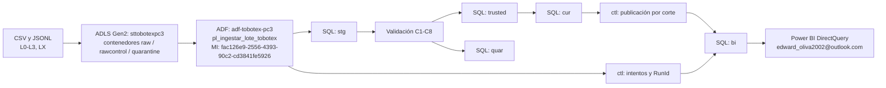

# Guía para producir las figuras F3-01 a F3-10

> Complemento de `CONTINUACION_GRUPO_11_PC3_INE_FASE_3.md`. Use nombres reales, sin secretos.
> Guarde cada imagen en `powerbi/exportaciones/figuras/F3-XX.png` (o `.svg` para F3-01).
> Si una evidencia no existe, déjela como **PENDIENTE**: no la reemplace por un valor esperado.

## Datos reales ya verificados (23/11/2026)

| Dato | Valor |
|---|---|
| Suscripción | `f57db137-2f2a-49e8-83f3-990b2c786c01` (Azure for Students) |
| Tenant | `dee9f998-d159-442c-a88d-f1171c748fa5` |
| Grupo de recursos | `rg-tobotex-pc3` |
| Región | `chilecentral` |
| Storage | `sttobotexpc3` (HNS, Standard_LRS); contenedores `raw`, `rawcontrol`, `quarantine` |
| Data Factory | `adf-tobotex-pc3`; pipeline `pl_ingestar_lote_tobotex` |
| Identidad ADF | `fac126e9-2556-4393-90c2-cd3841fe5926` (SystemAssigned) |
| SQL Server | `sql-tobotex-pc3.database.windows.net` |
| Bases | `sqldb-tobotex` (corte 6), `sqldb-control` (vacía). No existe `sqldb-test` |
| Admin Entra del servidor | `edward_oliva2002@outlook.com` |
| Usuario BI recomendado | `edward_oliva2002@outlook.com` (contenido en SQL, sin contraseña nueva) |
| Corte publicado | `corte_seq=6`, `corte_id=C-20261123-06`, lote `L3` |

## Reglas comunes de captura

1. Resolución legible: 1920×1080 o mayor, zoom 100 %, sin recortar encabezados ni filtros.
2. En capturas SQL/Power BI debe verse el nombre de la base y, si es posible, el usuario.
3. Ocultar contraseñas, cadenas de conexión, tokens y direcciones IP. El firewall ya tiene la IP `190.232.218.9`; no la muestres.
4. Cada archivo debe llevar pie de figura igual al del documento y una nota de fecha/hora de captura.
5. No presentes C0–C3 como `corte_id` reales. Su correspondencia observada es: C0≈2, C1≈3, C2≈4, C3≈6.

---

## F3-01 — Arquitectura

**No es captura de ejecución**: es un diagrama. Reemplaza el bloque Mermaid del documento por este, expórtalo desde [Mermaid Live](https://mermaid.live/) o la extensión Mermaid de VS Code y guárdalo como `F3-01_arquitectura.svg`/`.png`.



Incluye en el pie: grupo `rg-tobotex-pc3`, región `chilecentral`, bases `sqldb-tobotex` y `sqldb-control`, identidad administrada de ADF, usuario de ingesta `etl_loader` y lector `edward_oliva2002@outlook.com`/`bi_reader`. **No incluyas claves.**

---

## F3-02 — Orquestación y trazabilidad

1. Azure Portal → `adf-tobotex-pc3` → **Author (Crear)** → **Pipelines** → `pl_ingestar_lote_tobotex`.
2. Captura 1: lienzo completo con parámetros, validación, copia, preparación de despacho/reclamo, publicación y rama de error. Si el pipeline abierto no muestra todos esos bloques, captura lo que exista y anota la diferencia.
3. Captura 2: **Monitor (Supervisar)** → **Pipeline runs**, con lote, estado y `RunId`.
4. RunIds reales disponibles en `ctl.lote` para enlazar:

| Prueba | `lote_id` | Intento | `run_id` | Estado | `corte_seq` |
|---|---|---:|---|---|---:|
| L0 carga | L0 | 2 | `manual-L0-20261123T151249` | PUBLICADO | 2 |
| L1 | L1 | 1 | `manual-L1-20261123T151253` | PUBLICADO | 3 |
| L2 | L2 | 1 | `manual-L2-20261123T151256` | PUBLICADO | 4 |
| L3 falla | L3 | 1 | `manual-L3-20261123T151258` | FALLIDO | NULL |
| L3 recuperación | L3 | 2 | `manual-L3-20261123T151259` | PUBLICADO | 6 |
| LX | LX | 1 | `manual-LX-20261123T151257` | RECHAZADO_ESQUEMA | NULL |

Los `manual-...` **no son ejecuciones de ADF**. Si Monitor no muestra ejecuciones con esos IDs, no las llames RunId de Data Factory; usa la columna `run_id` de SQL y declara el origen.

---

## F3-03 — Clasificación y cuarentena de L1

Ejecuta en `sqldb-tobotex` y captura ambas tablas en la misma imagen o en dos imágenes consecutivas con la base visible:

```sql
SELECT lote_id, fuente, intento, filas_leidas, filas_ins, filas_upd,
       filas_omit, filas_rech, estado, run_id, corte_seq
FROM ctl.lote
WHERE lote_id = 'L1'
ORDER BY intento, fuente;

SELECT rechazo_id, fuente, lote_id, intento, clave, control, motivo, registrado_utc
FROM quar.rechazo
WHERE lote_id = 'L1'
ORDER BY rechazo_id;
```

Debe verse: `45 = 40 + 2 + 1 + 2` en el intento 1, y los dos rechazos `M000643 v1` (C6) y `M000642 v1` (C5).

---

## F3-04 — Reenvío sin cambios

```sql
SELECT lote_id, intento, fuente, filas_leidas, filas_ins, filas_upd,
       filas_omit, filas_rech, estado, run_id, corte_seq
FROM ctl.lote
WHERE lote_id = 'L1'
ORDER BY intento, fuente;

SELECT * FROM bi.v_comparacion_cortes WHERE periodo = '2026-09' AND corte_seq = 3;
```

Captura los intentos 1, 2 y 4: el 2 y el 4 terminan en `SIN_CAMBIOS` y conservan `corte_seq=3`. En la segunda consulta debe verse el neto `47170.72`. Añade la tarjeta del tablero con el mismo corte antes de dar la figura por terminada.

---

## F3-05 — Revisión de septiembre y tienda histórica

```sql
SELECT * FROM bi.v_corte_publicado;
SELECT corte_seq, corte_id, periodo, bruto, devuelto, neto
FROM bi.v_comparacion_cortes
WHERE periodo = '2026-09'
ORDER BY corte_seq;
SELECT * FROM bi.v_periodo_revisado ORDER BY periodo;
```

Valores observables: corte 2 `47179.72`, corte 3 `47170.72`, cortes 4 y 6 `46973.08`; `bi.v_periodo_revisado` marca `2026-09` con `C-20261123-04`. Etiqueta C0/C1/C2 en el pie como correspondencia, no como `corte_id`.

---

## F3-06 — Interrupción y recuperación de L3

```sql
SELECT lote_id, intento, run_id, estado, corte_seq, mensaje, inicio_utc, fin_utc
FROM ctl.lote
WHERE lote_id = 'L3'
ORDER BY intento;
SELECT * FROM bi.v_corte_publicado;
```

Captura 1: intento 1 `FALLIDO`, mensaje de falla simulada tras `fact_despacho`, `corte_seq=NULL`, y el corte publicado aún 4 en ese momento (si reproduces la prueba, hazlo en copia aislada). Captura 2: intento 2 `PUBLICADO`, `corte_seq=6`. El estado actual de la base ya es posterior a la recuperación: no lo llames «durante la falla».

---

## F3-07 — Separación de accesos

```sql
SELECT DB_NAME() AS base_actual, ORIGINAL_LOGIN() AS login_original, USER_NAME() AS usuario_sql;

SELECT pr.name usuario,
       CASE pn.class_desc WHEN 'SCHEMA' THEN SCHEMA_NAME(pn.major_id) ELSE 'BASE' END objeto,
       pn.permission_name, pn.state_desc
FROM sys.database_permissions pn
JOIN sys.database_principals pr ON pr.principal_id = pn.grantee_principal_id
WHERE pr.name IN (N'bi_reader', N'edward_oliva2002@outlook.com')
ORDER BY 1, 2, 3;

EXECUTE AS USER = 'bi_reader';
SELECT TOP (2) * FROM bi.v_k1;
SELECT TOP (1) * FROM stg.despacho;  -- debe fallar por permiso
REVERT;
```

Para `edward_oliva2002@outlook.com` usa el listado del catálogo: `GRANT SELECT` en `bi` y `DENY SELECT` en `ctl`, `cur`, `quar`, `stg`, `trusted`. Añade otra captura de **Storage account → Access control (IAM)** con la asignación de `Storage Blob Data Reader` a la identidad de ADF. **Verificación actual:** no se encontró esa asignación; si no la otorgas, documenta la ausencia en vez de simularla.

---

## F3-08 — Presupuesto y consumo

1. Portal → **Cost Management + Billing → Cost analysis**.
2. Ámbito: suscripción; filtro: `rg-tobotex-pc3`; moneda: USD; período: fechas reales de la prueba.
3. Captura 1: costo por servicio con fechas y hora de consulta visibles.
4. Captura 2: **Budgets** con presupuesto y alertas.
5. Si no hay datos, captura el mensaje «no data available» y escribe eso, no `0.00`.
6. Verificación del 23/11/2026: `az consumption budget list` devolvió `[]`, es decir, **no hay presupuesto creado**. La figura F3-08 queda PENDIENTE hasta crearlo/capturarlo; no inventes montos. Power BI Service también queda PENDIENTE de licencia.

---

## F3-09 — Comparación de consultas

1. Abre `pruebas/consultas/P7_A.sql`, `P7_B.sql` y `P7_EXCEPT.sql`.
2. Ejecuta primero los `EXCEPT`: ambos deben devolver cero filas; captura el resultado y luego una fila por mes/tienda para demostrar que no es un empate por duplicados.
3. Ejecuta cada alternativa tres veces, intercaladas, con:

```sql
SET STATISTICS IO ON;
SET STATISTICS TIME ON;
-- pegar aquí la consulta completa
SET STATISTICS TIME OFF;
SET STATISTICS IO OFF;
```

4. Captura la pestaña **Messages** con lecturas lógicas, CPU y duración. Si la diferencia es pequeña, concluye «mejora no demostrada en este volumen».

---

## F3-10 — Conciliación K2/K3

```sql
SELECT SUM(bruto_pen) AS bruto, SUM(devuelto_pen) AS devuelto,
       SUM(k2_neto_pen) AS neto
FROM bi.v_k2
WHERE periodo = '2026-09';

SELECT SUM(numerador_devuelto) AS numerador,
       SUM(denominador_despachado) AS denominador,
       ROUND(100.0 * SUM(numerador_devuelto) / SUM(denominador_despachado), 2) AS k3_pct
FROM bi.v_k3
WHERE periodo = '2026-09';
```

Esperado observado en SQL: bruto `47593.98`, devuelto `620.90`, neto `46973.08`, K3 `1.30 %`. La figura debe mostrar tres fuentes: (1) `revision_fase3/calculo_independiente_tobotex.txt`, (2) las consultas anteriores, (3) la página 1 del tablero con filtro `2026-09`, corte `C-20261123-06`, tarjetas K2/K3 y la hora de actualización. Hasta que exista `.pbix`, la tercera fuente queda PENDIENTE.
